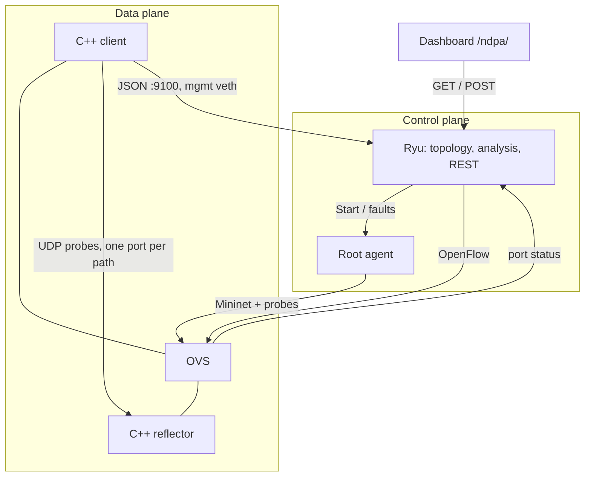

# SDN-Based Network Diagnostic and Path Analysis Tool

[](https://github.com/LonelyGuy-SE1/network-diagnostic-and-path-analysis/actions/workflows/ci.yml)
[](LICENSE)
[%20%7C%203.12%20(CI)-blue.svg)](https://www.python.org/)
[](telemetry/)
[](controller/)
[](topology/)

A socket-based network diagnostic application that measures **delay (RTT)**, **packet loss**, and **path characteristics** on every candidate path between hosts, correlates those measurements with a live **SDN topology**, identifies **failed / degraded** paths, and compares alternatives so live traffic can be steered onto the best path.

> Absolute RTT accuracy inside Mininet is limited by scheduler jitter. Results are interpreted relative to a healthy baseline, not as hardware-grade numbers.

---

## Objectives

| Goal | How this project meets it |
|------|---------------------------|
| Implement UDP diagnostic probes | C++ client/reflector (`telemetry/`) with raw POSIX sockets, sequence numbers, timeouts |
| Measure round-trip time | Per-path RTT min / avg / max via `CLOCK_MONOTONIC` |
| Detect packet loss | Sliding window over probe sequences → loss % |
| Implement path analysis | `controller/analysis.py`: healthy / degraded / failed + hysteresis |
| Discover SDN topology | Ryu LLDP + host learning (`ndpa_controller.py`) |
| Correlate app measurements with paths | Reports joined to enumerated switch routes; REST `/ndpa/paths` |
| Identify failed paths | Probe loss thresholds + OpenFlow port-down events |
| Compare alternative paths | Rank candidates and reroute live traffic (udp/5003) |

---

## Features

1. **Topology discovery**: switches, links, and host attachment points (default diamond, or the graph drawn in the dashboard).
2. **Per-path UDP probing**: each discovered route pinned by destination port (`5001`, `5002`, `5004`, …; `5003` is live traffic).
3. **Telemetry**: RTT (min/avg/max), jitter, and loss over an out-of-band TCP channel.
4. **Classification**: healthy / degraded / failed with hold-time to avoid flapping.
5. **Reroute**: live traffic moved to the best healthy alternative; decisions logged with timestamps.
6. **Live dashboard**: draw the graph, press **Start**, **Blackhole** / **Clear** a path, or take a live link down from Inventory.

---

## Architecture



The dashboard default is the diamond below. **Start** saves `topology/topo.json` and brings up that graph. Probe src/dst come from the **Probe from / to** selectors, not a hardcoded host pair.

### Default diamond paths

| Route | Probe port | Role |
|-------|------------|------|
| s1 → s2 → s4 | udp/5001 | Candidate path |
| s1 → s3 → s4 | udp/5002 | Candidate path |
| extra discovered routes | udp/5004, 5005, … | Up to 8 probe paths |
| follows the active route | udp/5003 | Live IPv4 / ARP between the probe pair |

Probe ports are assigned shortest-first from a pool of eight UDP ports, skipping `5003` so a third route still gets a probe.

### Control and REST

| Piece | Role |
|-------|------|
| Root agent (`./demo/gui.sh`) | One sudo prompt. Dashboard Start and faults talk to this helper |
| `GET /ndpa/health` | Agent, Mininet, hosts, paths, probe-report checklist |
| `GET /ndpa/topology` | Switches, links, hosts |
| `GET /ndpa/paths` | Path table, states, last reports, active path |
| `GET /ndpa/events` | Recent decisions |
| `POST /ndpa/run` | Save `topology/topo.json`; enqueue Mininet + C++ probes |
| `POST /ndpa/fault` | Blackhole, Clear, link down, link up |

### Design decisions

* **Path pinning by UDP port**: forward match `udp_dst`, echo match `udp_src`, so every candidate can be measured at once.
* **Soft vs hard faults**: **Blackhole** is `tc netem` 100% loss (link stays up; only probes see it). Inventory **del** on a live link takes the interface down (OpenFlow port-down). **+ Link** on the same pair brings it back.
* **Client reports, controller decides**: analysis stays next to the topology.
* **Control off the data path**: OpenFlow on loopback. Start adds a dedicated mgmt veth so JSON reports never share the probed links.
* **No ARP flooding**: static ARP + proactive flows (the topology has a loop).

### Tech stack

| Layer | Pieces |
|-------|--------|
| Probes | C++ `telemetry/{client,server,stats,report}.cpp`, `protocol.h` |
| Controller | Python / Ryu 4.34 (`controller/ndpa_controller.py`, `analysis.py`) |
| Emulation | Mininet + Open vSwitch (`topology/diamond.py`, `topo.json`) |
| GUI helper | `demo/gui.sh` + `demo/gui_agent.py` (root) + `demo/gui_demo.py` |
| UI | Static `frontend/` served by Ryu WSGI |
| CI | GitHub Actions (lint, C++ build/tests, Mininet integration, D1 demo) |

---

## Repository layout

```
protocol.h          shared 24-byte probe packet
telemetry/          C++ client, reflector, stats, Makefile
controller/         Ryu app + path classifier
frontend/           live dashboard (HTML/CSS/JS)
topology/           Mininet diamond topology
demo/               gui.sh (dashboard) and d1_demo.sh (headless)
tests/              unit + integration
eval/               benchmark hooks
docs/screenshots/   dashboard captures
.github/workflows/  CI
```

---

## How to run

Tested on Ubuntu. Ryu 4.34 needs **Python 3.9** in `.venv`.

### 1. System packages

```bash
sudo apt install mininet openvswitch-switch
```

### 2. Ryu venv

```bash
uv venv --python 3.9 .venv
uv pip install "setuptools<66" wheel pbr eventlet==0.30.2
uv pip install --no-build-isolation ryu==4.34
```

### 3. Build + unit tests

```bash
make -C telemetry all test
python3 tests/test_analysis.py
python3 tests/test_eval_metrics.py
```

### 4. Launch the live stack

```bash
./demo/gui.sh
```

This starts the controller and a root helper (sudo once). Press **Start** on the dashboard to bring up Mininet and the C++ probes. Dashboard: http://127.0.0.1:8080/ndpa/

`--serve` is the same command. Ctrl-C stops the agent; Ryu keeps running.

Headless end-to-end check (no dashboard; uses the fixed diamond):

```bash
sudo ./demo/d1_demo.sh
```

Set `RYU_MANAGER` if `ryu-manager` is not on `.venv/bin`. For the CLI demo only, pass `--datapath user` when the OVS kernel module is unavailable:

```bash
sudo ./demo/d1_demo.sh --datapath user
```

---

## Evaluation scenarios

| # | Scenario | Trigger |
|---|----------|---------|
| 1 | Healthy baseline | No faults |
| 2 | Soft failure | Dashboard **Blackhole** (`tc netem` 100% loss; link stays up) |
| 3 | Hard failure | Inventory **del** on a live link (port down) |
| 4 | Recovery | **Clear** netem, or **+ Link** on the same pair |

**Metrics:** RTT and loss per path (before/after reroute), detection time, recovery time.

---

## Screenshots

From a live GUI run against Ryu at `/ndpa/` (real C++ probes + Mininet diamond). Path names are the switch route (`s1-s2-s4`), not letters.

| # | Capture | What it shows |
|---|---------|----------------|
| 1 | Baseline | Both paths healthy; live on s1→s2→s4 |
| 2 | Soft blackhole | s1→s2→s4 failed (100% loss); live moved to s1→s3→s4 |
| 3 | Hard failure | Alternate path failed on port-down; PORT / CLASSIFY / REROUTE events |
| 4 | Metrics | RTT min/avg/max, jitter, loss after recovery |

### Baseline


### Soft blackhole and reroute


### Hard failure and event log


### Paths table metrics


---

## Video demo

A recorded walkthrough is not in the repo yet. Suggested script: start `./demo/gui.sh`, press **Start**, show healthy paths, **Blackhole** one path, show classification and reroute, inventory-**del** a live link, **+ Link** to restore, **Clear** netem, show recovery.

---

## Team contributions

| Member | Focus |
|--------|--------|
| Greeshma Surya | Probe engine, Ryu controller and analysis, Mininet topology, demos, dashboard, CI |
| Divyansi KV | |
| Bhanu Teja | |

---

## CI

[](https://github.com/LonelyGuy-SE1/network-diagnostic-and-path-analysis/actions/workflows/ci.yml)

Workflow: [`.github/workflows/ci.yml`](.github/workflows/ci.yml)

| Job | What it runs |
|-----|----------------|
| **Lint** | `py_compile` + `flake8` |
| **Build and unit tests** | C++ build/tests, analysis and eval unit tests |
| **Mininet integration** | Path-pinning integration test |
| **Controller demo** | Full `d1_demo` on `main` pushes (also runnable via Actions → Run workflow) |
