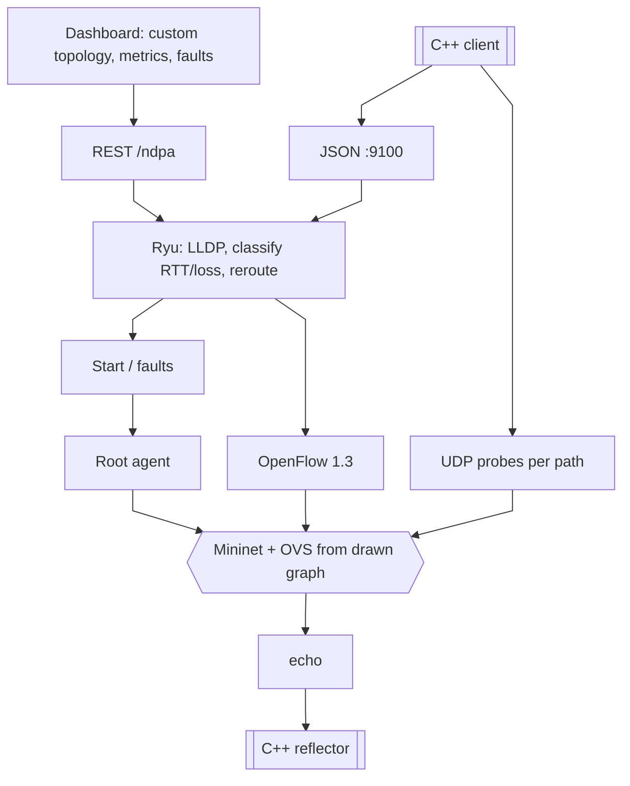
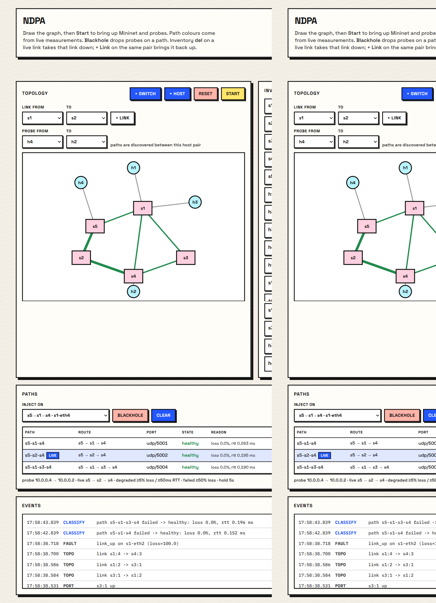
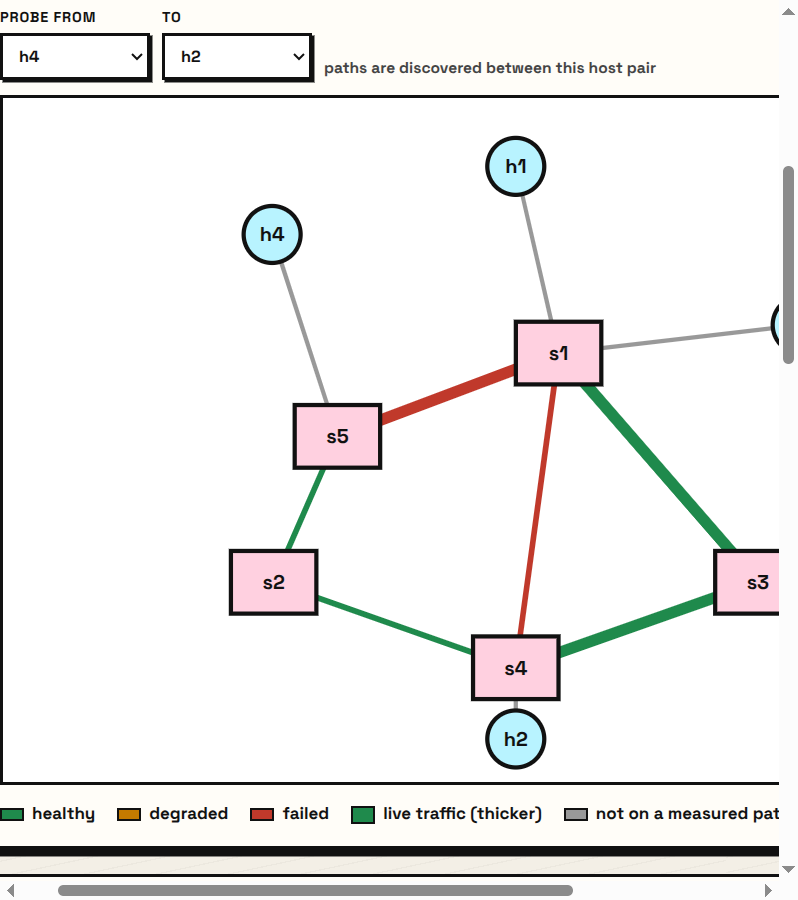
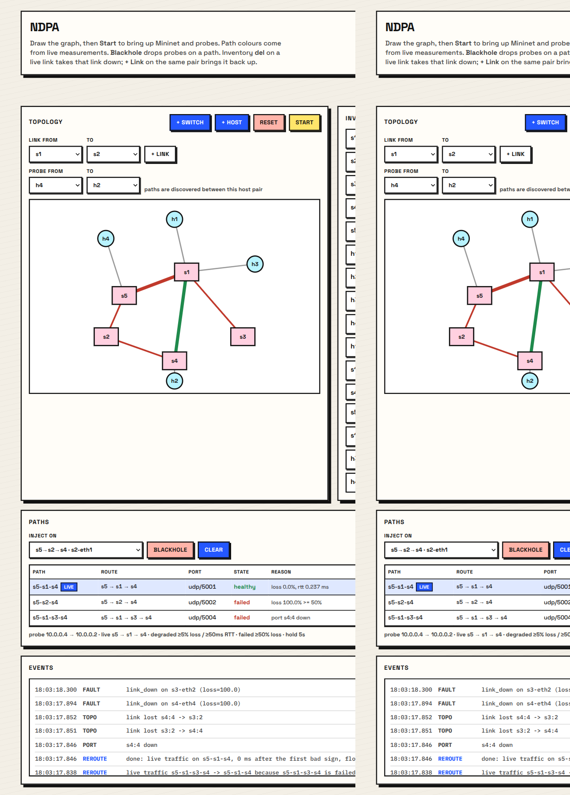
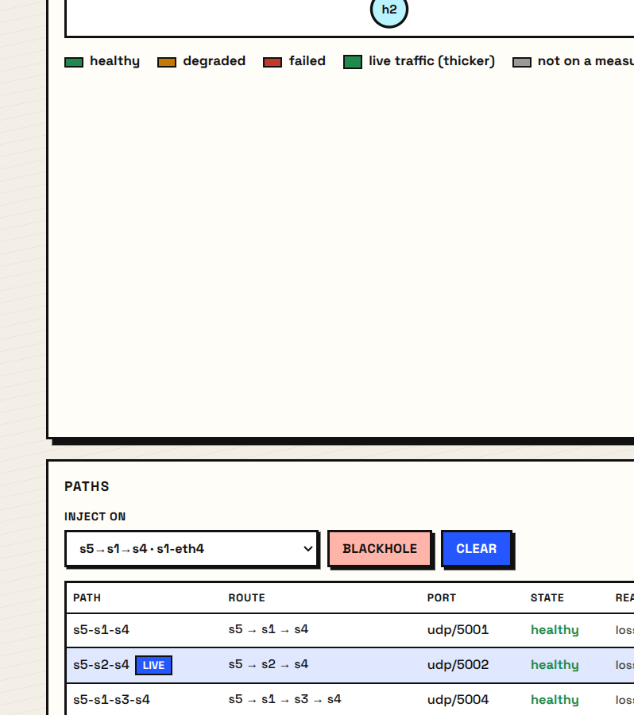

# SDN-Based Network Diagnostic and Path Analysis Tool

[](https://github.com/LonelyGuy-SE1/network-diagnostic-and-path-analysis/actions/workflows/ci.yml)
[](LICENSE)
[%20%7C%203.12%20(CI)-blue.svg)](https://www.python.org/)
[](telemetry/)
[](controller/)
[](topology/)

A socket-based network diagnostic application that measures **delay (RTT)**, **packet loss**, and **path characteristics** on every candidate path between hosts, correlates those measurements with a live **SDN topology**, identifies **failed / degraded** paths, and compares alternatives so live traffic can be steered onto the best path.

> Absolute RTT accuracy inside Mininet is limited by scheduler jitter. Results are interpreted relative to a healthy baseline, not as hardware-grade numbers.

---

## Video demo

[](https://www.youtube.com/watch?v=-sVWE2T29I4)

[Watch on YouTube](https://www.youtube.com/watch?v=-sVWE2T29I4)

---

## Objectives

| Goal | How this project meets it |
|------|---------------------------|
| Implement UDP diagnostic probes | C++ client/reflector (`telemetry/`) with raw POSIX sockets, sequence numbers, timeouts |
| Measure round-trip time | Per-path RTT min / avg / max via `CLOCK_MONOTONIC` |
| Detect packet loss | Sliding window over probe sequences → loss % |
| Implement path analysis | `controller/analysis.py`: healthy / degraded / failed + hysteresis |
| Discover SDN topology | Ryu LLDP + host learning (`ndpa_controller.py`) |
| Correlate app measurements with paths | Reports joined to enumerated switch routes; REST `/ndpa/paths` |
| Identify failed paths | Probe loss thresholds + OpenFlow port-down events |
| Compare alternative paths | Rank candidates and reroute live traffic (udp/5003) |

---

## Features

1. **Topology discovery**: switches, links, and host attachment points on the graph you draw.
2. **Per-path UDP probing**: each discovered route pinned by destination port (`5001`, `5002`, `5004`, …; `5003` is live traffic).
3. **Telemetry**: RTT (min/avg/max), jitter, and loss over an out-of-band TCP channel.
4. **Classification**: healthy / degraded / failed with hold-time to avoid flapping.
5. **Reroute**: live traffic moved to the best healthy alternative; decisions logged with timestamps.
6. **Live dashboard**: draw the graph, press **Start**, **Blackhole** / **Clear** a path, or take a live link down from Inventory.

---

## Architecture



Draw any graph in the dashboard (the starting draft is a diamond). **Start** brings that graph up in Mininet. Ryu discovers switch routes between **Probe from / to**, pins each one with its own UDP port (`5001`, `5002`, `5004`, …; `5003` is live traffic), and classifies reports from the C++ client. **Blackhole** drops probes on a path while the link stays up. Inventory **del** takes a live link down.

---

## Repository layout

```
protocol.h          shared 24-byte probe packet
telemetry/          C++ client, reflector, stats, Makefile
controller/         Ryu app + path classifier
frontend/           live dashboard (HTML/CSS/JS)
topology/           Mininet graphs (GUI draft or diamond default)
demo/               gui.sh (dashboard) and d1_demo.sh (headless)
tests/              unit + integration
eval/               benchmark hooks
docs/screenshots/   dashboard captures
.github/workflows/  CI
```

---

## How to run

Tested on Ubuntu. Ryu 4.34 needs **Python 3.9** in `.venv`.

### 1. System packages

```bash
sudo apt install mininet openvswitch-switch
```

### 2. Ryu venv

```bash
uv venv --python 3.9 .venv
uv pip install "setuptools<66" wheel pbr eventlet==0.30.2
uv pip install --no-build-isolation ryu==4.34
```

### 3. Build + unit tests

```bash
make -C telemetry all test
python3 tests/test_analysis.py
python3 tests/test_eval_metrics.py
```

### 4. Launch the live stack

```bash
./demo/gui.sh
```

This starts the controller and a root helper (sudo once). Press **Start** on the dashboard to bring up Mininet and the C++ probes. Dashboard: http://127.0.0.1:8080/ndpa/

`--serve` is the same command. Ctrl-C stops the agent; Ryu keeps running.

Headless end-to-end check (no dashboard; uses the fixed diamond):

```bash
sudo ./demo/d1_demo.sh
```

Set `RYU_MANAGER` if `ryu-manager` is not on `.venv/bin`. For the CLI demo only, pass `--datapath user` when the OVS kernel module is unavailable:

```bash
sudo ./demo/d1_demo.sh --datapath user
```

---

## Evaluation

Dashboard **Start** shows live RTT min/avg/max, jitter, and loss on every discovered path. Faults:

| # | Scenario | Dashboard trigger |
|---|----------|-------------------|
| 1 | Healthy | No faults |
| 2 | Blackhole | **Blackhole** (`tc netem` 100% loss; link stays up) |
| 3 | Hard fail | Inventory **del** on a live link (port down) |
| 4 | Recovery | **Clear** netem, or **+ Link** on the same pair |

Static shortest-path vs this controller, measured on the diamond (kernel OVS, 8 s warmup, 10 s hold, 12 s settle, 100 pkt/s live UDP, 9 Nov 2026):

```bash
sudo python3 eval/benchmark.py --ryu .venv/bin/ryu-manager --reps 1
```

| Scenario | Static outage | Dynamic outage | Detect | Reroute |
|----------|---------------|----------------|--------|---------|
| healthy | 0.0 ms | 0.0 ms | n/a | n/a |
| soft (60 ms + 20% loss) | 60.0 ms | 30.0 ms | 2489.4 ms | 9.5 ms |
| blackhole (100% loss) | 10020.0 ms | 3490.0 ms | 3510.8 ms | 7.2 ms |
| hard (link down) | 10020.0 ms | 20.0 ms | 34.9 ms | 13.1 ms |

`n/a` means there was no fault (healthy) or the static baseline never classifies. Full table and CSV: [`docs/benchmark.md`](docs/benchmark.md), [`eval/results/d2-static-vs-dynamic/runs.csv`](eval/results/d2-static-vs-dynamic/runs.csv).

---

## Screenshots

Live GUI at `/ndpa/` (C++ probes on the graph below, probe h4 → h2).

| # | Capture | What it shows |
|---|---------|----------------|
| 1 | Baseline | Three paths healthy; live on s5→s2→s4 |
| 2 | Soft blackhole | s5→s2→s4 failed (100% loss); live moved |
| 3 | Hard failure | Link down on the live path; PORT / CLASSIFY / REROUTE |
| 4 | Metrics | RTT min/avg/max, jitter, loss after recovery |

### Baseline



### Soft blackhole and reroute



### Hard failure and event log



### Paths table metrics



---

## Team contributions

| Member | Focus |
|--------|--------|
| Greeshma Surya | Probe engine, Ryu controller and analysis, Mininet topology, demos, dashboard, CI |
| Divyansi KV | |
| Bhanu Teja | |

---

## CI

[](https://github.com/LonelyGuy-SE1/network-diagnostic-and-path-analysis/actions/workflows/ci.yml)

Workflow: [`.github/workflows/ci.yml`](.github/workflows/ci.yml)

| Job | What it runs |
|-----|----------------|
| **Lint** | `py_compile` + `flake8` |
| **Build and unit tests** | C++ build/tests, analysis and eval unit tests |
| **Mininet integration** | Path-pinning integration test |
| **Controller demo** | Full `d1_demo` on `main` pushes (also runnable via Actions → Run workflow) |
