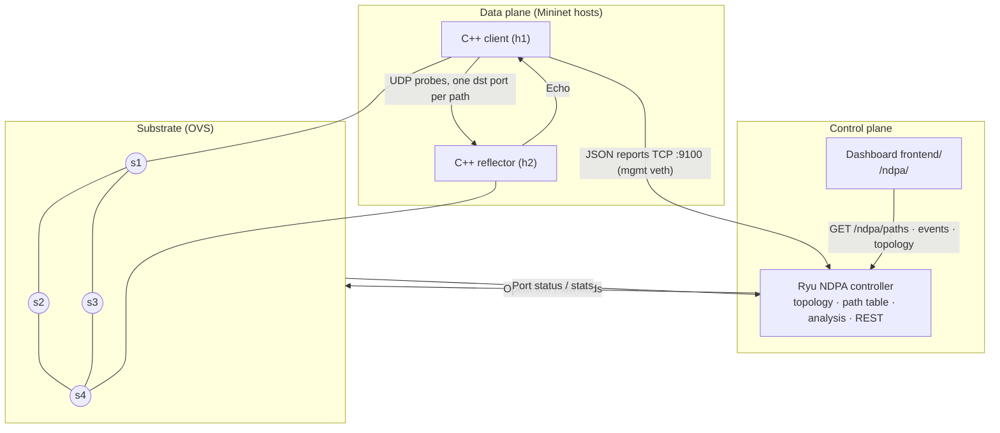

# SDN-Based Network Diagnostic and Path Analysis Tool

[](https://github.com/LonelyGuy-SE1/network-diagnostic-and-path-analysis/actions/workflows/ci.yml)
[](LICENSE)
[%20%7C%203.12%20(CI)-blue.svg)](https://www.python.org/)
[](telemetry/)
[](controller/)
[](topology/)

A socket-based network diagnostic application that measures **delay (RTT)**, **packet loss**, and **path characteristics** on every candidate path between hosts, correlates those measurements with a live **SDN topology**, identifies **failed / degraded** paths, and compares alternatives so live traffic can be steered onto the best path.

> Absolute RTT accuracy inside Mininet is limited by scheduler jitter; results are interpreted relative to a healthy baseline, not as hardware-grade numbers.

---

## Objectives

| Goal | How this project meets it |
|------|---------------------------|
| Implement UDP diagnostic probes | C++ client/reflector (`telemetry/`) with raw POSIX sockets, sequence numbers, timeouts |
| Measure round-trip time | Per-path RTT min / avg / max via `CLOCK_MONOTONIC` |
| Detect packet loss | Sliding window over probe sequences → loss % |
| Implement path analysis | `controller/analysis.py`: healthy / degraded / failed + hysteresis |
| Discover SDN topology | Ryu LLDP + host learning (`ndpa_controller.py`) |
| Correlate app measurements with paths | Reports joined to enumerated switch routes; REST `/ndpa/paths` |
| Identify failed paths | Probe loss thresholds + OpenFlow port-down events |
| Compare alternative paths | Rank candidates and reroute live traffic (udp/5003) |

---

## Features

1. **Topology discovery** — switches, links, and host attachment points.
2. **Per-path UDP probing** — each candidate path pinned by destination port (A=`5001`, B=`5002`).
3. **Telemetry** — RTT (min/avg/max), jitter, loss, reported over an out-of-band TCP channel.
4. **Classification** — healthy / degraded / failed with hold-time to avoid flapping.
5. **Reroute** — live traffic moved to the best healthy alternative; decisions logged with timestamps.
6. **Live dashboard** — `frontend/` at http://127.0.0.1:8080/ndpa/ (served by Ryu).
7. **Two demos** — CLI end-to-end check and GUI live demo (see below).

---

## Architecture / design



### Default diamond paths

| Path | Route | Probe port |
|------|-------|------------|
| A | s1 → s2 → s4 | udp/5001 |
| B | s1 → s3 → s4 | udp/5002 |
| Live | follows **active** path | udp/5003 |

### Design decisions

* **Path pinning by UDP port** — forward match `udp_dst`, echo match `udp_src`, so all paths can be measured at once.
* **Two failure modes** — hard (`link down` → OpenFlow port status) vs soft (`tc netem` → only probes see it).
* **Client reports, controller decides** — analysis stays next to the topology.
* **Control off the data path** — OpenFlow on loopback; telemetry on a dedicated mgmt veth (`diamond.py --mgmt`).
* **No ARP flooding** — static ARP + proactive flows (topology has a loop).

### Tech stack

| Layer | Pieces |
|-------|--------|
| Probes | C++ `telemetry/{client,server,stats,report}.cpp`, `protocol.h` |
| Controller | Python / Ryu 4.34 — `controller/ndpa_controller.py`, `analysis.py` |
| Emulation | Mininet + Open vSwitch — `topology/diamond.py` |
| UI | Static `frontend/` served by Ryu WSGI |
| CI | GitHub Actions — lint, C++ build/tests, Mininet path integration |

---

## Repository layout

```
protocol.h          shared 24-byte probe packet
telemetry/          C++ client, reflector, stats, Makefile
controller/         Ryu app + path classifier
frontend/           live dashboard (HTML/CSS/JS)
topology/           Mininet diamond (+ optional topo.json from GUI)
demo/               gui.sh (one-shot GUI) · d1_demo.sh (CLI) · helpers
tests/              unit + integration
eval/               D2 benchmark hooks
docs/screenshots/   dashboard captures (filled after a live run)
.github/workflows/  CI
```

---

## How to run

Tested on Ubuntu. Ryu 4.34 needs **Python 3.9** in `.venv`.

### 1. System packages

```bash
sudo apt install mininet openvswitch-switch
```

### 2. Ryu venv

```bash
uv venv --python 3.9 .venv
uv pip install "setuptools<66" wheel pbr eventlet==0.30.2
uv pip install --no-build-isolation ryu==4.34
```

### 3. Build + unit tests

```bash
make -C telemetry all test
python3 tests/test_analysis.py
python3 tests/test_eval_metrics.py
```

### 4. Demos (do not mix)

| Demo | Command | Behaviour |
|------|---------|-----------|
| **GUI (recommended)** | `./demo/gui.sh` | One command: starts Ryu in the background, asks for **sudo once**, runs the live fault demo, leaves an agent so dashboard **Demo/Run** work without passwordless sudo. Open http://127.0.0.1:8080/ndpa/ |
| **GUI (agent only)** | `./demo/gui.sh --serve` | Ryu + root agent only; trigger faults from the dashboard buttons. |
| **CLI (D1)** | `sudo ./demo/d1_demo.sh` | Self-contained. **Kills any existing `ndpa_controller`**, starts its own Ryu, asserts reroute, exits. Logs → `demo-logs/`. Do not use this for the live dashboard. |

> **Never** run `mn -c` while the dashboard Ryu is up — Mininet cleanup runs `killall ryu-manager`. `gui.sh` / `gui_demo.sh` / `gui_run.sh` avoid that.

Pass `--datapath user` to the CLI demo if the OVS kernel module is unavailable. Set `RYU_MANAGER` to override the venv binary.

---

## Evaluation scenarios

| # | Scenario | Trigger |
|---|----------|---------|
| 1 | Healthy baseline | No faults |
| 2 | Soft degradation | `tc netem` delay / loss on a path |
| 3 | Hard failure | `link down` mid-transfer |
| 4 | Recovery | Link / netem restored |

**Metrics:** RTT and loss per path (before/after reroute), detection time, recovery time.  
**Baseline (D2):** static shortest path without reroute, same traffic.

---

## Screenshots

Captured from a live `sudo ./demo/gui_demo.sh` run against Ryu at `/ndpa/` (real C++ probes + Mininet diamond).

| # | Capture | What it shows |
|---|---------|----------------|
| 1 | Baseline | Both paths healthy; live traffic on **A** |
| 2 | Soft blackhole | Path **A** failed (100% loss); live moved to **B** |
| 3 | Hard link-down | Path **B** failed (`port … down`); live back on **A**; PORT / CLASSIFY / REROUTE events |
| 4 | Metrics | RTT min/avg/max, jitter, loss after recovery |

### 1 — Baseline (healthy)


### 2 — Path A failed → reroute to B


### 3 — Path B link down + event log


### 4 — Paths table metrics


---

## Video demo

Record a short walkthrough (CLI and/or GUI):

1. Start the chosen demo (`d1_demo.sh` or Ryu + `gui_demo.sh`).
2. Show healthy paths and live traffic on the dashboard.
3. Soft-fail path A (`tc netem`), then hard-fail path B (`link down`); show CLASSIFY + REROUTE.
4. Restore and show recovery / hold behaviour.

Upload to your course portal or link a private Drive/YouTube URL here when ready:

```text
Video: <add link after recording>
```

Tip: `./demo/gui.sh --hold 60` leaves a longer watch window after the fault timeline.

---

## Team contributions

Contributors on GitHub: [LonelyGuy-SE1](https://github.com/LonelyGuy-SE1), [divyansi](https://github.com/divyansi).

| Member | Focus areas (repo / delivery) |
|--------|--------------------------------|
| **LonelyGuy-SE1** | C++ probe engine, Ryu controller & analysis, Mininet topology, integration demos (`d1_demo` / `gui_demo`), live dashboard, CI |
| **Divyansi** | Early repository / project setup contributions |

*Adjust this table to match your official team roster and mark-sheet roles before submission.*

---

## CI / CD

[](https://github.com/LonelyGuy-SE1/network-diagnostic-and-path-analysis/actions/workflows/ci.yml)
[](.github/workflows/ci.yml)

Workflow: [`.github/workflows/ci.yml`](.github/workflows/ci.yml) — runs on every **pull request**, every **push to `main`**, and on **manual `workflow_dispatch`**.

| Job | Trigger | What it runs |
|-----|---------|----------------|
| **Lint** | always | `py_compile` + `flake8` on tracked Python |
| **Build and unit tests** | always | `make -C telemetry all test`, analysis + eval unit tests |
| **Mininet integration** | after lint+build | OVS/Mininet install, `tests/integration/test_paths.py`, log artifact |
| **D1 controller demo** | `main` push or manual dispatch | Full `./demo/d1_demo.sh --datapath user` with Ryu 4.34 |

There is no separate deploy/CD stage — this is a research/demo stack. “Release” is merging to `main` with a green CI badge. Use **Actions → CI → Run workflow** to re-run the heavier D1 job without a commit.

---

## Execution plan

### Phase 1 — Telemetry (done)

Packet format, multi-port probing, RTT / loss / jitter, TCP reports to the controller.

### Phase 2 — Controller & analysis (done)

Topology discovery, path pinning, ingest, port status, classify / compare / reroute.

### Phase 3 — Topology, demos, dashboard (done for D1)

Diamond topology, CLI + GUI demos, live `/ndpa/` UI. D2: broader CSV/plots under `eval/`.

---

## Rules of engagement

* Work on a branch or fork; open a PR for every contribution.
* Test your module in isolation before integration.
* Prefer Ubuntu LTS to avoid namespace / OVS conflicts.
