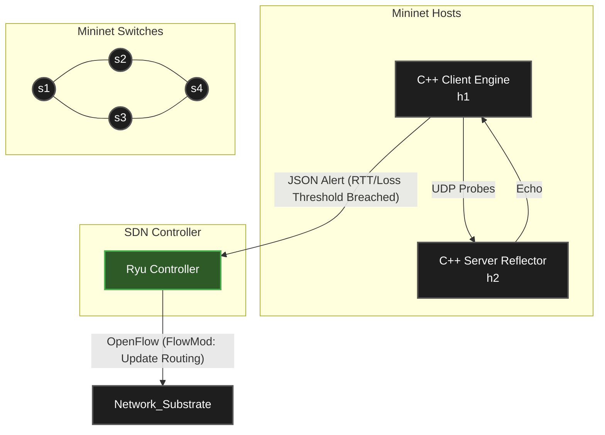

# SDN-Driven Network Diagnostics & Self-Healing Routing

This repository contains a closed-loop SDN system that actively monitors network health and dynamically routes traffic around degraded links. To avoid garbage collection overhead and ensure microsecond precision, the telemetry engine is built entirely in C++ using raw POSIX sockets, while network state is managed by a Ryu OpenFlow controller.

## System Architecture

## Tech Stack & Core Modules

* **Telemetry Engine (C++):** Custom UDP client and server binaries running on Mininet hosts. The client tracks sequence numbers and microsecond-level timestamps to calculate exact Round-Trip Time (RTT) and packet loss.

* **Control Plane (Python / Ryu):** The central brain. It maps the network graph at startup. When it receives an anomaly payload from the C++ client, it marks the degraded link, recalculates the shortest path using Dijkstra, and pushes OpenFlow rules to the switches to reroute traffic.

* **Network Substrate (Mininet):** The virtual environment provisioning redundant paths and allowing us to simulate physical link failures to test dynamic recovery.

## Execution Pipeline & Ownership

### Phase 1: Core Sockets & Telemetry 

* Implement `protocol.h`, `server.cpp`, and `client.cpp` using raw socket system calls to handle datagram transmission, concurrency, and timeout handling.

* Implement the baseline math for RTT and sequence drop detection.
* Establish the telemetry dispatch system to alert the controller of threshold breaches.

### Phase 2: SDN Controller & Path Analysis 

* Write the Ryu script to discover the initial Mininet topology.

* Open a listener socket to ingest telemetry alerts from the C++ engine.

* Implement the path analysis logic to identify the failed link, compare alternative paths, and dynamically update switch flow tables via OpenFlow.

### Phase 3: Infrastructure & Benchmarking 

* Script the multi-path Mininet topology.

* Script the "challenging scenario" (e.g., dropping a link via Mininet CLI mid-transmission).

* Capture output metrics and plot the performance evaluation graphs (static baseline vs. dynamic rerouting) for the final documentation.

## Rules of Engagement

* Always create/use a branch/fork and pr for any contributions.
* Test your module in isolation before integration. Python logic will not fix broken C++ memory layouts, and C++ will not fix broken OpenFlow state.
* Use standard Ubuntu LTS for development to prevent namespace and OVS conflicts.
