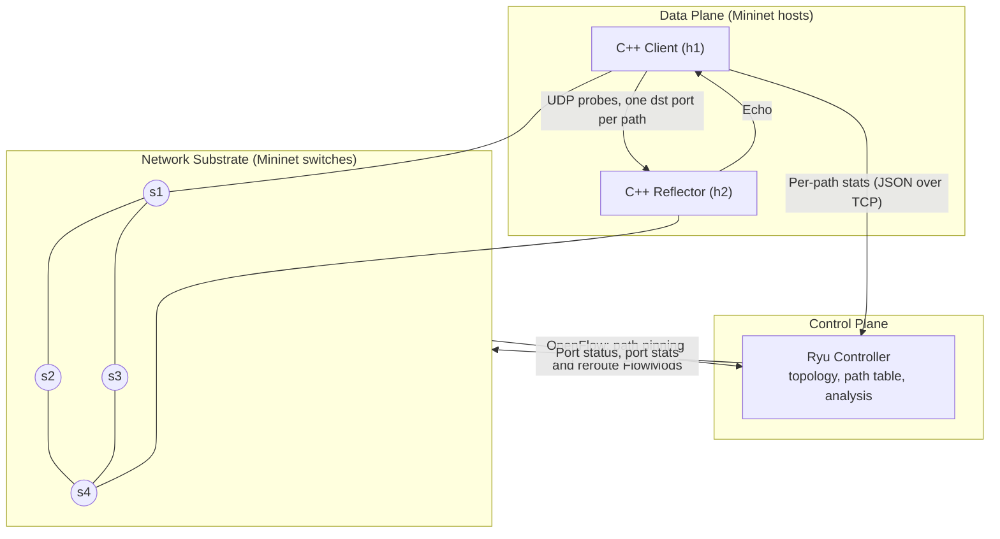

# SDN-Based Network Diagnostic and Path Analysis Tool

A UDP diagnostic tool that measures RTT and packet loss on every candidate path between two hosts, correlates those measurements with the SDN topology, and identifies which paths are degraded or failed. A Ryu OpenFlow controller uses the results to steer live traffic onto the best path.

The probe engine is written in C++ with raw POSIX sockets. It timestamps with `clock_gettime(CLOCK_MONOTONIC)` and keeps per-probe overhead low. Absolute accuracy inside Mininet is still limited by scheduler jitter, so results are compared relative to a static baseline rather than treated as hardware-grade numbers.

## What it does

1. **Discovers the topology.** Ryu builds the switch and link graph at startup and enumerates the candidate paths between the probe hosts.
2. **Probes each path separately.** The controller pins each path using its own UDP destination port, so one client can probe all paths at the same time.
3. **Measures.** For every path the client reports RTT (min / avg / max / jitter) and packet loss using sequence numbers and timestamps.
4. **Correlates.** The controller joins the application-level numbers with its own link and port statistics and produces a per-path report.
5. **Identifies failed and degraded paths.** A path is failed if probes get no replies or a port goes down, and degraded if RTT or loss crosses a threshold.
6. **Compares alternatives and reroutes.** Live traffic is moved to the best healthy path, and the change is logged with timestamps for the recovery-time measurement.

## System architecture



Paths between h1 and h2 in the default topology:

| Path | Route | Probe port |
|------|-------|------------|
| A | s1 - s2 - s4 | TBD |
| B | s1 - s3 - s4 | TBD |

## Design decisions

* **Path pinning by UDP port.** The controller installs flows that match on UDP destination port (forward) and source port (echo) and forward along one specific path. This is what lets the client measure paths independently.
* **Two kinds of failure, two detection routes.**
  * Hard failure (`link s1 s2 down`): detected from OpenFlow port status events, so it is fast.
  * Soft degradation (added delay or loss via `tc netem`): only visible through the probe telemetry. This is where the C++ engine matters.
* **Client reports, controller decides.** The client sends per-path stats about once a second plus an immediate alert on a threshold breach. The analysis logic stays in the controller, where the topology is known.
* **Control traffic stays off the tested links.** There are two channels, and they are handled differently.
  * **OpenFlow (switches to Ryu):** Ryu runs externally and Mininet attaches to it with `RemoteController` (default `127.0.0.1:6653`). The OVS switches run in the root namespace, so this channel goes over the host loopback and never crosses the virtual links we break during tests. No extra setup is needed.
  * **Telemetry (h1 to Ryu):** Mininet hosts live in their own network namespaces and cannot reach the VM's `127.0.0.1`, so this channel needs its own path. Plan: attach a root-namespace interface with its own IP to s1 (the pattern in Mininet's `examples/sshd.py`) and have the client send its JSON reports to that IP over TCP. That link only touches s1, so it does not cross s1-s2, s1-s3, s2-s4 or s3-s4. It needs a flow entry on s1 and a static ARP entry. Exact setup: TBD until tested.
* **No flooding.** The topology has a loop, so ARP is handled with static ARP entries and flows are installed proactively in both directions.

## Tech stack

* **Telemetry engine (C++):** `protocol.h`, `client.cpp`, `server.cpp`. Fixed-width packed structs with explicit `htonl` / `htons` for the wire format. Sequence numbers, timeouts, per-path state.
* **Controller (Python / Ryu):** topology discovery, path table, flow installation, stats collection, analysis, rerouting.
* **Network (Mininet + Open vSwitch):** multi-path topology script and fault injection scripts.

## Evaluation

**Scenarios**

| # | Scenario | How it is triggered |
|---|----------|---------------------|
| 1 | Healthy network | No faults, collect per-path baseline |
| 2 | Soft degradation | `tc netem` delay and loss on one path |
| 3 | Hard link failure mid-transfer | `link s1 s2 down` in the Mininet CLI |
| 4 | Recovery | `link s1 s2 up`, check the path is reused |

**Metrics:** RTT per path, loss per path (before and after reroute), detection time, recovery time, throughput during the event.

**Baseline:** static shortest path with no rerouting, same scenarios, same traffic.

**Output:** results are written to CSV and plotted as static vs dynamic graphs for the report.

## Repository layout (planned)

```
protocol.h
telemetry/   client.cpp  server.cpp  Makefile
controller/  (Ryu app)
topology/    (Mininet topology and fault scripts)
eval/        (run scripts, CSVs, plotting)
docs/
```

## How to run

To be filled in once the pieces exist. The final version must cover:

1. Environment setup (Ubuntu LTS, Mininet, Open vSwitch, Ryu, g++)
2. Building the C++ binaries
3. Starting the Ryu app
4. Starting the Mininet topology
5. Starting the server and client on h2 and h1
6. Running each evaluation scenario and collecting results

## Execution plan

### Phase 1: Telemetry engine (owner: TBD)

* `protocol.h`, `server.cpp`, `client.cpp` with raw socket calls: datagram send/receive, timeouts, multi-port probing.
* RTT calculation, sequence-based loss detection, jitter.
* Per-path stats reporting to the controller.

### Phase 2: Controller and path analysis (owner: TBD)

* Ryu app that discovers the topology and builds the path table.
* Path pinning flows, stats ingestion, port status handling.
* Analysis: classify each path as healthy, degraded or failed, compare alternatives, reroute live traffic.

### Phase 3: Topology and benchmarking (owner: TBD)

* Multi-path Mininet topology script with static ARP.
* Fault injection scripts for the scenarios above.
* Metric capture, baseline runs, plots.

## Rules of engagement

* Work on a branch or fork and open a PR for every contribution.
* Test your module in isolation before integration. Python logic will not fix broken C++ memory layouts, and C++ will not fix broken OpenFlow state.
* Use standard Ubuntu LTS to avoid namespace and OVS conflicts.
