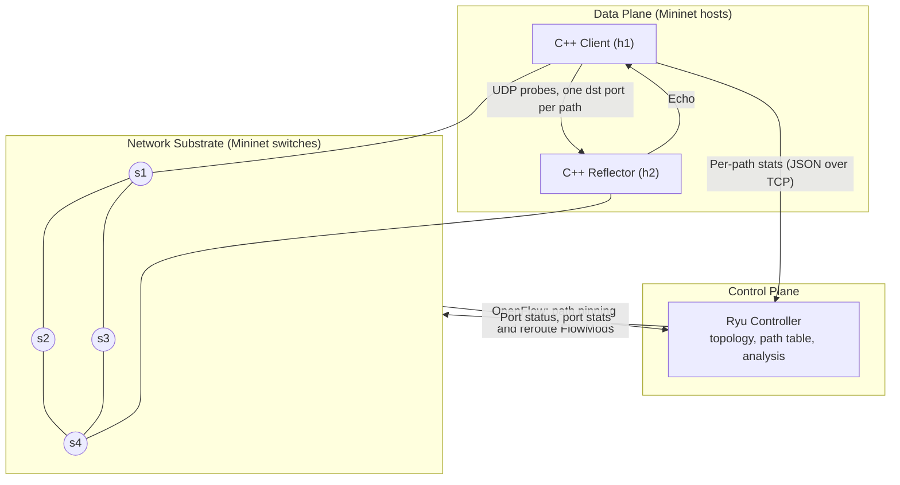

# SDN-Based Network Diagnostic and Path Analysis Tool

A UDP diagnostic tool that measures RTT and packet loss on every candidate path between two hosts, correlates those measurements with the SDN topology, and identifies which paths are degraded or failed. A Ryu OpenFlow controller uses the results to steer live traffic onto the best path.

The probe engine is written in C++ with raw POSIX sockets. It timestamps with `clock_gettime(CLOCK_MONOTONIC)` and keeps per-probe overhead low. Absolute accuracy inside Mininet is still limited by scheduler jitter, so results are compared relative to a static baseline rather than treated as hardware-grade numbers.

## What it does

1. **Discovers the topology.** Ryu builds the switch and link graph at startup and enumerates the candidate paths between the probe hosts.
2. **Probes each path separately.** The controller pins each path using its own UDP destination port, so one client can probe all paths at the same time.
3. **Measures.** For every path the client reports RTT (min / avg / max / jitter) and packet loss using sequence numbers and timestamps.
4. **Correlates.** The controller joins the application-level numbers with the topology it discovered (which switches and links each path crosses) and produces a per-path report. It also polls switch port counters, which are logged but not used to classify a path.
5. **Identifies failed and degraded paths.** A path is failed if probes get no replies or a port goes down, and degraded if RTT or loss crosses a threshold.
6. **Compares alternatives and reroutes.** Live traffic is moved to the best healthy path, and the change is logged with timestamps for the recovery-time measurement.

## System architecture



Paths between h1 and h2 in the default topology:

| Path | Route | Probe port |
|------|-------|------------|
| A | s1 - s2 - s4 | udp/5001 |
| B | s1 - s3 - s4 | udp/5002 |

Live traffic in the demo uses udp/5003 and is steered onto whichever path is active.

## Design decisions

* **Path pinning by UDP port.** The controller installs flows that match on UDP destination port (forward) and source port (echo) and forward along one specific path. This is what lets the client measure paths independently.
* **Two kinds of failure, two detection routes.**
  * Hard failure (`link s1 s2 down`): detected from OpenFlow port status events, so it is fast.
  * Soft degradation (added delay or loss via `tc netem`): only visible through the probe telemetry. This is where the C++ engine matters.
* **Client reports, controller decides.** The client sends per-path stats about once a second. The analysis logic stays in the controller, where the topology is known.
* **Control traffic stays off the tested links.** There are two channels, and they are handled differently.
  * **OpenFlow (switches to Ryu):** Ryu runs externally and Mininet attaches to it with `RemoteController` (default `127.0.0.1:6653`). The OVS switches run in the root namespace, so this channel goes over the host loopback and never crosses the virtual links we break during tests. No extra setup is needed.
  * **Telemetry (h1 to Ryu):** Mininet hosts live in their own network namespaces and cannot reach the host's `127.0.0.1`, so this channel gets its own link. `diamond.py --mgmt` adds a veth pair between h1 (`192.168.100.1`) and the root namespace (`192.168.100.254`). It does not touch any switch, so it never crosses s1-s2, s1-s3, s2-s4 or s3-s4. The client sends its JSON reports to `192.168.100.254:9100` over TCP.
* **No flooding.** The topology has a loop, so ARP is handled with static ARP entries and flows are installed proactively in both directions.

## Tech stack

* **Telemetry engine (C++):** `protocol.h`, `telemetry/client.cpp`, `telemetry/server.cpp`, plus `stats.cpp` (RTT, jitter, loss) and `report.cpp` (JSON reports). A fixed 24-byte packed packet with explicit byte order conversion. Sequence numbers, timeouts, per-path state.
* **Controller (Python / Ryu):** `controller/ndpa_controller.py` (topology discovery, path table, flow installation, report intake, rerouting) and `controller/analysis.py` (classification).
* **Network (Mininet + Open vSwitch):** `topology/diamond.py`. Faults are injected with `tc netem` and `link down` / `link up`.

## Evaluation

**Scenarios**

| # | Scenario | How it is triggered |
|---|----------|---------------------|
| 1 | Healthy network | No faults, collect per-path baseline |
| 2 | Soft degradation | `tc netem` delay and loss on one path |
| 3 | Hard link failure mid-transfer | `link s1 s2 down` in the Mininet CLI |
| 4 | Recovery | `link s1 s2 up`, check the path is reused |

**Metrics:** RTT per path, loss per path (before and after reroute), detection time, recovery time, throughput during the event.

**Baseline:** static shortest path with no rerouting, same scenarios, same traffic.

**Output:** results are written to CSV and plotted as static vs dynamic graphs for the report.

## Repository layout

```
protocol.h     packet format shared by client and server
telemetry/     C++ client, reflector, stats and report code, Makefile
controller/    Ryu app (ndpa_controller.py) and path classifier (analysis.py)
topology/      Mininet diamond topology (diamond.py)
demo/          d1_demo.sh, the end-to-end demo
tests/         unit tests and integration tests (tests/integration/)
```

`eval/` (benchmark scripts, CSVs, plots) is added for Deliverable 2.

## How to run

Tested on Ubuntu with Python 3.9 for Ryu (Ryu 4.34 does not run on newer Python versions).

1. **Install system packages**

   ```
   sudo apt install mininet openvswitch-switch
   ```

2. **Create the Ryu environment** (from the repo root)

   ```
   uv venv --python 3.9 .venv
   uv pip install "setuptools<66" wheel pbr eventlet==0.30.2
   uv pip install --no-build-isolation ryu==4.34
   ```

3. **Build the C++ binaries and run the unit tests**

   ```
   make -C telemetry all test
   ```

4. **Run the end-to-end demo.** It builds the binaries, starts Ryu and the Mininet diamond topology, starts the reflector on h2 and the client on h1, injects faults on the active path and checks that live traffic is rerouted.

   ```
   sudo ./demo/d1_demo.sh
   ```

   Logs are written to `demo-logs/` (`ryu.log`, `client.log`, flow dumps). Pass `--datapath user` if the OVS kernel module is not available. Set `RYU_MANAGER` to use a `ryu-manager` from somewhere other than `.venv`.

## Execution plan

### Phase 1: Telemetry engine (done)

* `protocol.h`, `server.cpp`, `client.cpp` with raw socket calls: datagram send/receive, timeouts, multi-port probing.
* RTT calculation, sequence-based loss detection, jitter.
* Per-path stats reporting to the controller.

### Phase 2: Controller and path analysis (done)

* Ryu app that discovers the topology and builds the path table.
* Path pinning flows, report ingestion, port status handling.
* Analysis: classify each path as healthy, degraded or failed, compare alternatives, reroute live traffic.

### Phase 3: Topology and benchmarking (in progress)

* Multi-path Mininet topology script with static ARP (done).
* Fault injection for the scenarios above (done for the D1 demo).
* Metric capture, baseline runs, plots (Deliverable 2).

## Rules of engagement

* Work on a branch or fork and open a PR for every contribution.
* Test your module in isolation before integration. Python logic will not fix broken C++ memory layouts, and C++ will not fix broken OpenFlow state.
* Use standard Ubuntu LTS to avoid namespace and OVS conflicts.
